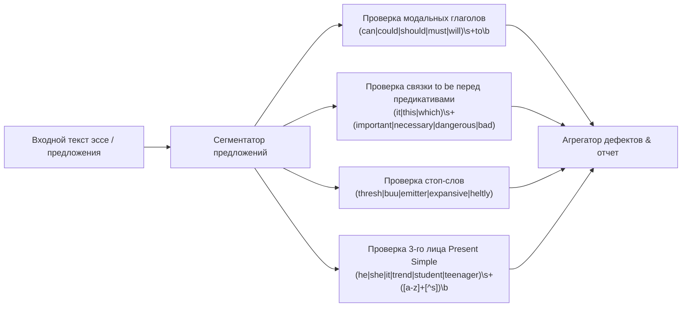

# Архитектурная Спецификация: IELTS Writing Accelerator

## 1. Архитектурный паттерн (Clean Architecture + MVI)

Приложение спроектировано в виде трех строго разделенных слоев. Вся бизнес-логика инкапсулирована в UseCases и не зависит от Android фреймворка, что гарантирует 100% покрытие модульными тестами.

```mermaid
graph TD
    subgraph Presentation Layer ["Слой представления (UI)"]
        ComposeScreen["Jetpack Compose Screens"]
        ViewModel["MVI ViewModel<br>(StateFlow & Intents)"]
    end

    subgraph Domain Layer ["Доменный слой (Бизнес-логика)"]
        UseCaseLinter["ScrapcodeLinterUseCase"]
        UseCasePEEL["ValidatePEELStructureUseCase"]
        UseCaseScore["EstimateIELTSBandUseCase"]
        Models["Domain Models (Sentence, Rule, Essay)"]
    end

    subgraph Data Layer ["Слой данных (Data)"]
        RepoImpl["Repository Implementation"]
        RoomDB[("Room Database (SQLite)")]
        LocalCache["Local SharedPreferences / DataStore"]
        GeminiClient["Optional Gemini API Client (REST)"]
    end

    ComposeScreen -->|Intents| ViewModel
    ViewModel -->|StateFlow| ComposeScreen
    ViewModel -->|Calls| Domain Layer
    Domain Layer -->|Interfaces| RepoImpl
    RepoImpl --> RoomDB
    RepoImpl --> LocalCache
    RepoImpl --> GeminiClient
```

---

## 2. Модель Потока Данных (MVI Pattern)

1. **User Action / Intent**: Пользователь вводит текст предложения в тренажере `SentenceSurgeryScreen` или нажимает «Проверить».
2. **ViewModel**: Перехватывает `Intent`, вызывает соответствующий `UseCase`.
3. **Domain Layer**:
   * Выполняет детерминированный разбор текста локальным движком `ScrapcodeLinter`.
   * Выявляет нарушение правил (например: отсутствие связки `to be`, наличие `cannot to`, отсутствие `-s` в 3-м лице).
4. **State Update**: Обновляет `UIState` (`Success`, `ErrorFound`, `Loading`), транслируемый в UI через `StateFlow`.
5. **Persistence**: Асинхронно логирует дефект в таблицу `MistakeLogEntity` в Room DB.

---

## 3. Схема Базы Данных (Room DB)

### 3.1. Сущность `MistakeEntity`
* `id: String` (UUID)
* `targetBand: Double` (`6.0`, `6.5`, `7.0`)
* `category: String` (`GRA_VERB_MISSING`, `GRA_MODAL_TO`, `GRA_3RD_PERSON_S`, `LR_WORD_FAMILY`, `LR_STOP_WORD`, `GRA_COMPLEX_CLAUSE`, `LR_COLLOCATION`, `GRA_NOMINALIZATION`)
* `rawSentence: String`
* `correctedSentence: String`
* `ruleExplanation: String`
* `repetitionLevel: Int` (Алгоритм интервального повторения Spaced Repetition)
* `lastPracticedTimestamp: Long`

### 3.2. Сущность `DrillEntity`
* `id: String`
* `targetBand: Double` (`6.0`, `6.5`, `7.0`)
* `type: String` (`BLOCK_BUILDER`, `ERROR_HUNTING`, `SLOT_FILLING`, `STYLE_UPGRADE`)
* `prompt: String`
* `options: List<String>` (Конвертируется через TypeConverter)
* `correctAnswer: String`
* `explanation: String`

### 3.3. Сущность `EssayEntity`
* `id: String`
* `taskType: Int` (1 - Report, 2 - Opinion/Discussion)
* `topic: String`
* `content: String`
* `timeSpentSeconds: Int`
* `overviewHasNoData: Boolean` (Для Task 1)
* `peelParagraphCount: Int` (Для Task 2)
* `aiExaminerFeedback: String?` (Опционально)
* `createdAt: Long`

---

## 4. Локальный Движок Линтинга (Scrapcode Linter Engine)

Линтер функционирует полностью автономно на регулярных выражениях и токенизации предложений:



---

## 5. Модуль AI-Аугментации (Gemini API)

* Использует легковесный HTTP-клиент (Ktor Client).
* Эндпоинт вызывается **только** по явному запросу пользователя («Аудит Экзаменатора») при наличии интернета.
* Промпт строго структурирован под критерии **IELTS Public Band Descriptors (May 2023)**:
  * TR/TA (Task Achievement / Response)
  * CC (Coherence & Cohesion)
  * LR (Lexical Resource)
  * GRA (Grammatical Range & Accuracy)
* Ответ парсится в строгий JSON-формат для сохранения в локальную БД.
