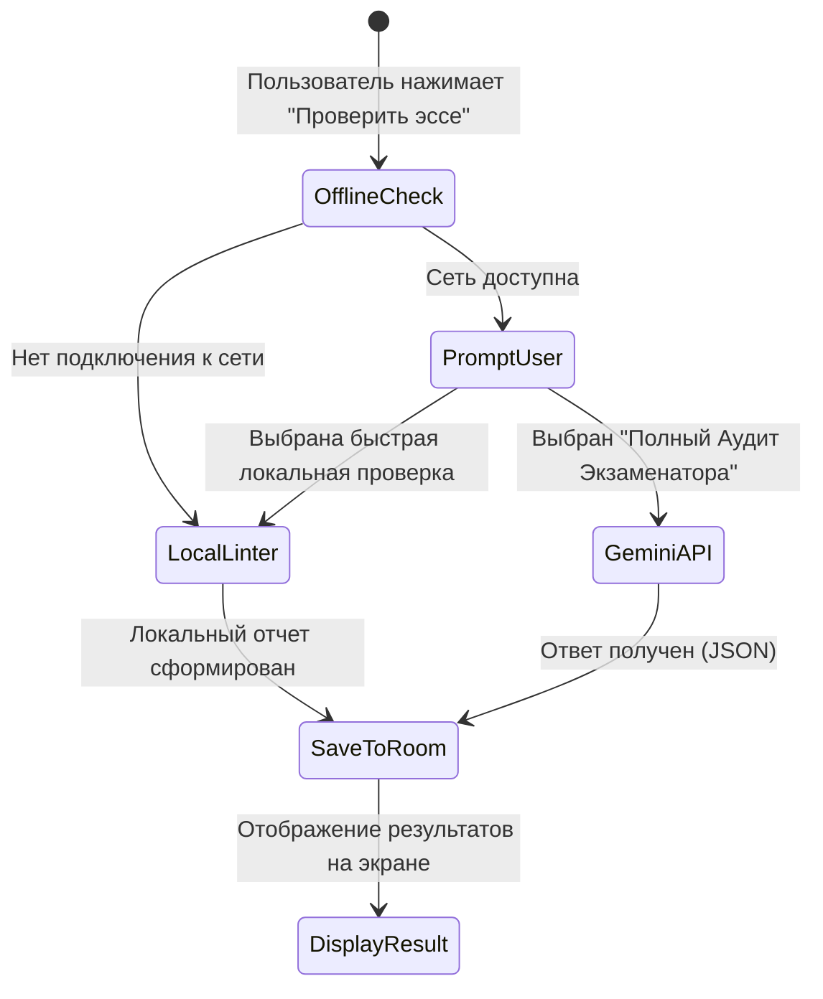

# Спецификация Режима Блэкаута (100% Offline-First)

## 1. Концепция автономного функционирования

Приложение спроектировано для работы в условиях полного отсутствия электроэнергии и доступа к глобальной сети Интернет.
*   **Zero-Network Core**: 100% тренировочных модулей не создают HTTP/Socket запросов.
*   **Локальное хранилище данных**: База данных SQLite под управлением Room ORM компилируется непосредственно в бинарный файл приложения.
*   **Энергоэффективность**: Отсутствие фоновых опросов (polling), фоновых сетевых служб (background daemons) и тяжелых анимаций. Интерфейс Jetpack Compose оптимизирован под Dark Theme по умолчанию для минимизации расхода аккумулятора OLED/AMOLED дисплеев смартфона.

---

## 2. Локальный банк данных (Prepopulated Room DB)

При первой инициализации приложения Room Database автоматически наполняется начальным датасетом через `RoomDatabase.Callback().onCreate()`:
1.  **50+ предложений с системным скрапкодом** (из реальных эссе Магоса) для модуля *Sentence Surgery*.
2.  **30 карточек Word Families** с типичными капканами частей речи (*dominate / dominant / dominance*).
3.  **Таблица Стоп-Слов** со звуковыми/визуальными предупреждениями.
4.  **Справочник формул PEEL** и шаблонных коннекторов для Task 1 и Task 2.

---

## 3. Гибридный шлюз к Gemini API (Online Fallback)

*   Ключ Gemini API хранится локально в шифрованном хранилище `EncryptedSharedPreferences` / `DataStore`.
*   При сбое сети приложение автоматически откатывается на локальный анализ, сохраняя непрерывность тренировки.
